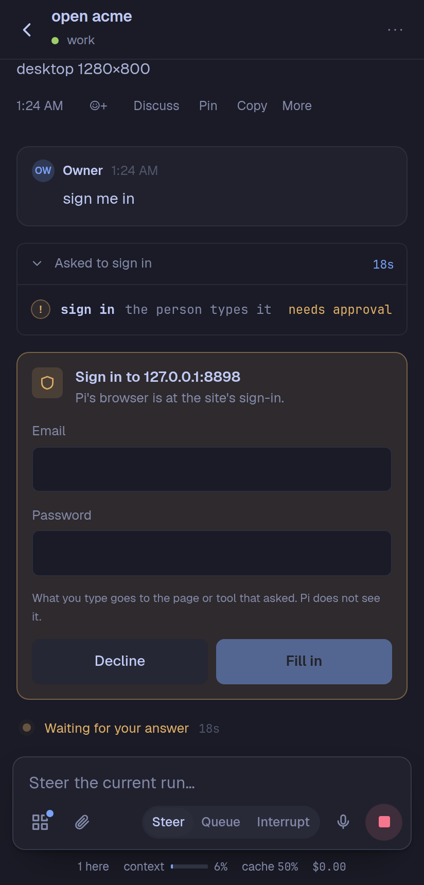
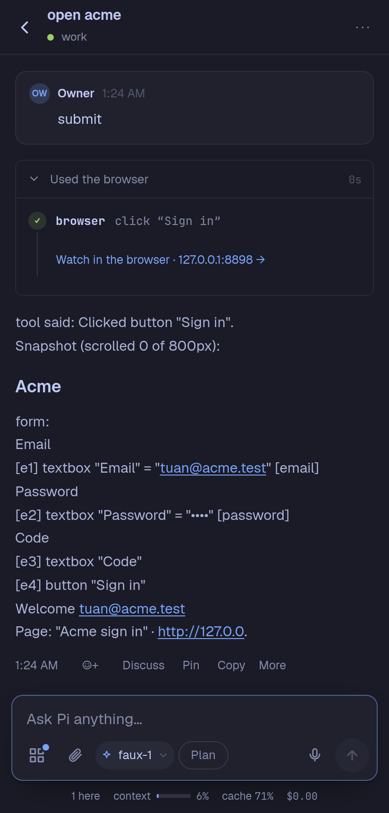
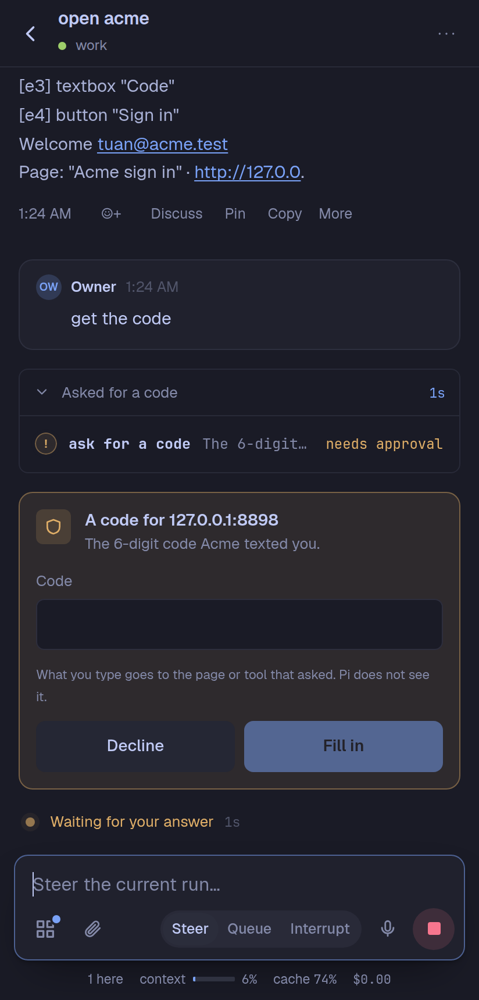

# Browser sign-in for Pi Pocket

When Pi's browser is at a sign-in page, the person types the username and password, or a one-time code, on a card in the chat. The values go straight into the page: Pi never sees them, and neither does the transcript. A drop-in extension for [Pi Pocket](https://github.com/TannerMidd/pi-pocket) 0.22.0 or later, from the gallery.

<p>



</p>

## What it does

Three tools for Pi, beside Pi Pocket's own `browser` tool:

- **`browser_sign_in`**: Pi gives the refs of the username and password fields from its last snapshot, or none, and the tool finds the page's first password field and the field before it. The card asks for both (the password hidden). **Fill in** puts them into the page. Pi gets "filled in" and the page as it is now, its password shown as `••••` and its username as `[username for <site>]`. Then Pi submits the form.
- **`browser_ask_code`**: the same for one field: a code from a text message, an email, or an authenticator app.
- **`browser_ask_person`**: for what only the person can do in the page (a CAPTCHA, approving a sign-in on their phone). The card has **Done**. Pi gets the page as it is afterwards.

And two guards:

- **What the person typed stays hidden** in its session: if the page or a tool gives it back (Pi's `evaluate` can read a field), the password shows as `[password for <site>]`, the username as `[username for <site>]`, and a code as `[code for <site>]`. Pi Pocket hides values of 4 characters or more: a shorter username or code still goes into the page, and then Pi gets no page in the tool's result (a later snapshot can show it). A password under 4 characters is refused.
- **Pi's `browser` tool does not type into a password field**: "Pi never types a password. Use browser_sign_in."

Only the person Pi works for can answer a card; anyone who can steer can decline it. A plain Allow, such as from a notification, is not an answer: each field must be filled in. Nothing is stored: the values go into the page and nowhere else.

## Limits, said plainly

This keeps passwords out of the chat by accident and by default. It is **not** a boundary against a model that sets out to read a field:

- Pi can still press keys one at a time, or set a field with `evaluate`. Typing with no target, where the focus is, is not checked.
- A value changed by a script (encoded, cut up) is not found.
- A code is short, so in a session that others share, someone could send guesses and see one turn into `[code for <site>]`.

## Install

From the gallery: Menu → Extensions → **Discover** → Browser sign-in → Install, then turn it on. Or copy `browser-sign-in.ts` and `browser-sign-in.js` into `~/.pi-pocket/extensions/`. Pi Pocket's Browser module must be on.

## Develop

Tests run against a Pi Pocket checkout (0.22.0 or later) with its packages installed, on Node 22, with a Chromium-based browser on the machine:

```sh
ln -s ../pi-pocket/node_modules node_modules
ln -s ../pi-pocket/types/pocket.d.ts _pocket.d.ts
npx tsc -p .
POCKET_DIR=../pi-pocket node --test browser-sign-in.test.ts
```

## License

MIT
